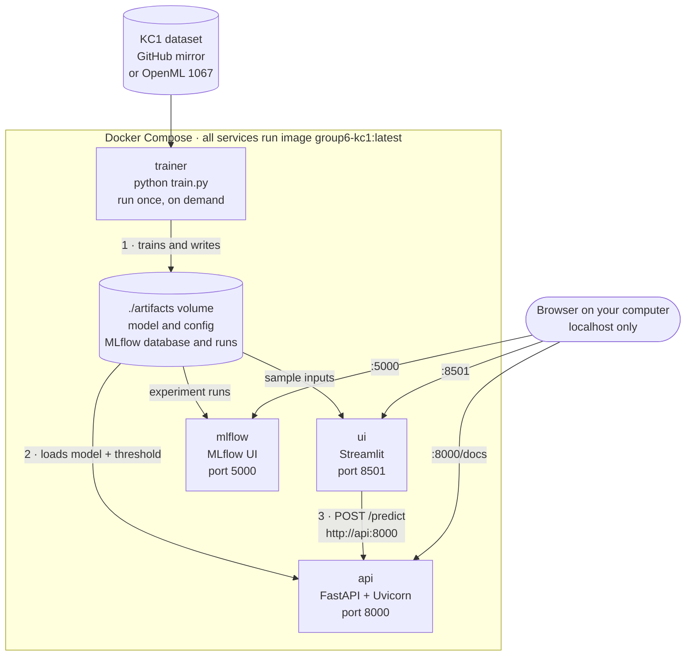
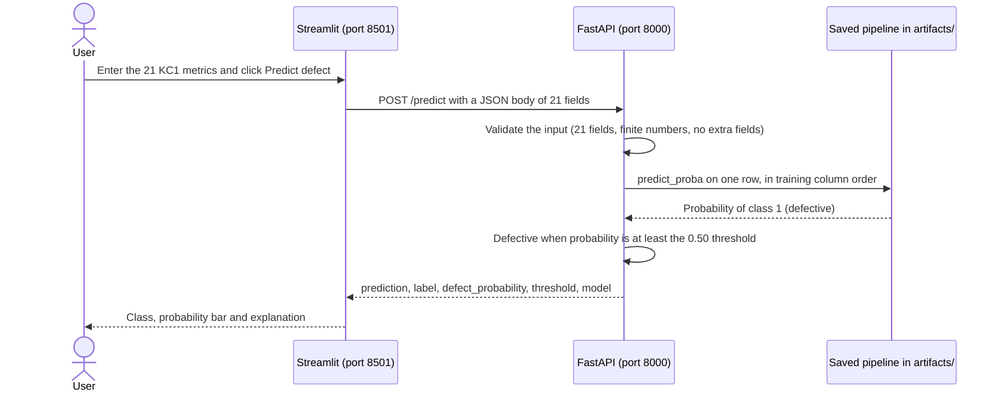

# KC1 Software Defect Prediction — ESAIP MSc Group 6

This project predicts whether a software module is likely to contain defects, using 21 static
code metrics from the NASA PROMISE **KC1** dataset. It covers the complete workflow: training
and comparing models, tracking every experiment in **MLflow**, serving the selected model
through a **FastAPI** REST API, offering a **Streamlit** interface, and packaging everything
with **Docker** and **Docker Compose**.

> **This repository contains source code and documentation only.** The dataset copy, trained
> model, MLflow database and exported Docker image are produced locally and are deliberately
> kept out of Git (see [What is not in Git](#what-is-not-in-git)).

## Project at a glance

| Item | Value |
|---|---|
| Dataset | NASA PROMISE KC1: 2,109 module records, **1,212 analysed** after removing duplicate rows |
| Inputs | **21** numeric static code metrics (size, McCabe complexity, Halstead, line counts) |
| Target | `defects`: 1 = defective, 0 = non-defective (26 % of analysed modules are defective) |
| Models compared | Logistic Regression and Random Forest (each default and class-balanced), plus an unsupervised Gaussian Mixture Model (GMM) |
| Selected model | **Balanced Logistic Regression** (`StandardScaler` + `LogisticRegression(class_weight="balanced")`) |
| Test F1 at threshold 0.50 | **0.500** |
| GMM components selected | **4** (lowest BIC) |
| Experiment tracking | MLflow with a SQLite backend |
| Prediction API | FastAPI + Uvicorn: `GET /health`, `POST /predict` |
| User interface | Streamlit |
| Containers | Docker image `group6-kc1:latest`, four Docker Compose services |

## Contents

1. [Architecture](#architecture)
2. [Dataset](#dataset)
3. [Models and model selection](#models-and-model-selection)
4. [Experiment tracking with MLflow](#experiment-tracking-with-mlflow)
5. [Docker image](#docker-image)
6. [Build and run](#build-and-run)
7. [Prediction workflow](#prediction-workflow)
8. [Results](#results)
9. [Testing](#testing)
10. [Sharing the Docker image](#sharing-the-docker-image)
11. [Repository structure](#repository-structure)
12. [What is not in Git](#what-is-not-in-git)
13. [Troubleshooting](#troubleshooting)
14. [Limitations](#limitations)

## Architecture



- **One image, four services.** `compose.yaml` builds a single image, `group6-kc1:latest`, and
  runs it four times with different commands.
- **Train once, serve many times.** The `trainer` service only runs when it is called with the
  `train` profile. It writes the fitted pipeline, its configuration and the MLflow runs to
  `./artifacts`, which is mounted into every container at `/app/artifacts`. The API loads that
  pipeline at start-up and never retrains.
- **Service-to-service networking.** Streamlit calls the API at `http://api:8000`; Docker's
  internal network resolves the service name `api`.
- **Local-only ports.** Ports are published on `127.0.0.1`, so the demo is reachable from the
  computer running Docker but not from other devices on the network.

| Service | Started by | Command inside the container | Open on your computer |
|---|---|---|---|
| `trainer` | `docker compose --profile train run --rm trainer` | `python train.py` | nothing (exits when finished) |
| `api` | `docker compose up -d` | `uvicorn api_app:app --host 0.0.0.0 --port 8000` | http://localhost:8000/docs |
| `ui` | `docker compose up -d` (waits until `api` is healthy) | `streamlit run streamlit_app.py` | http://localhost:8501 |
| `mlflow` | `docker compose up -d` | `mlflow ui --backend-store-uri sqlite:////app/artifacts/mlflow.db` | http://localhost:5000 |

## Dataset

- **Source:** NASA PROMISE KC1. `train.py` uses `artifacts/kc1.csv` if it exists; otherwise it
  downloads the CSV from a public GitHub mirror (`ApoorvaKrisna/NASA-promise-dataset-repository`),
  falls back to OpenML dataset 1067, and saves the downloaded copy as `artifacts/kc1.csv`.
- **Cleaning:** labels `true`/`false` become `1`/`0`; exact duplicate rows are removed
  (2,109 → **1,212** rows: 315 defective, 897 non-defective); the script checks that exactly the
  21 expected predictors are present, numeric and without missing values.
- **Split:** 80 % training / 20 % test, stratified by label, `random_state = 606`, giving
  **969** training and **243** test modules (63 defective in the test set).

| Group (as in the Streamlit tabs) | Features |
|---|---|
| Complexity | `loc`, `v(g)`, `ev(g)`, `iv(g)`, `branchCount` |
| Halstead metrics | `n`, `v`, `l`, `d`, `i`, `e`, `b`, `t` |
| Code structure | `lOCode`, `lOComment`, `lOBlank`, `locCodeAndComment` |
| Operators and operands | `uniq_Op`, `uniq_Opnd`, `total_Op`, `total_Opnd` |

## Models and model selection

`train.py` fits four supervised candidates on the same training split:

| Candidate | Pipeline | Class weighting |
|---|---|---|
| Logistic default | `StandardScaler` → `LogisticRegression(max_iter=5000)` | none |
| Logistic balanced | `StandardScaler` → `LogisticRegression(max_iter=5000, class_weight="balanced")` | balanced |
| Random Forest default | `RandomForestClassifier(n_estimators=300)` | none |
| Random Forest balanced | `RandomForestClassifier(n_estimators=300, class_weight="balanced")` | balanced |

**Selection rule** (the same as the team's original notebook):

1. Rank the candidates by **recall** on the held-out test set, then by **average precision**.
   Recall comes first because a missed defective module usually costs more than an extra review.
2. For the chosen model, compare decision thresholds **0.30, 0.50 and 0.70** and keep the best
   **F1** (then recall).

Outcome: **Balanced Logistic Regression** with a decision threshold of **0.50**.

**Unsupervised comparison (GMM).** The 21 features are standardised and Gaussian Mixture Models
with 2, 3 and 4 components (diagonal covariance, 10 initialisations) are fitted **without the
defect labels**. The number of components with the lowest BIC is kept (**4**). Labels are used
only afterwards, to describe the defect rate inside each component.

**Files written by training** (all in `artifacts/`, all excluded from Git):

| File | Content |
|---|---|
| `kc1_defect_pipeline.joblib` | selected fitted scikit-learn pipeline, loaded by the API |
| `deployment_config.json` | selected model name, MLflow run ID, threshold, feature order |
| `streamlit_defaults.json` | first held-out test module, used as the Streamlit sample |
| `model_comparison.csv`, `threshold_comparison.csv`, `balanced_logistic_thresholds.csv` | metric tables |
| `gmm_bic.csv`, `gmm_component_summary.csv`, `gmm_analysis.joblib` | GMM results and fitted GMM |
| `mlflow.db`, `mlruns/` | MLflow tracking database and logged models |
| `kc1.csv` | local copy of the dataset |

## Experiment tracking with MLflow

- **Experiment name:** `Group6_KC1_Defect_Prediction`
- **Backend store:** SQLite database `artifacts/mlflow.db`; logged models in `artifacts/mlruns/`
- **One training run records 10 MLflow runs:**

| MLflow runs | Parameters | Metrics | Artifacts |
|---|---|---|---|
| 4 classifier runs: `Logistic default`, `Logistic balanced`, `Random Forest default`, `Random Forest balanced` | model name, algorithm, random state, threshold | precision, recall, F1, average precision, false positives, false negatives | fitted model with signature and input example |
| 3 threshold runs: `Threshold 0.30 / 0.50 / 0.70 (balanced Logistic)` | experiment, model, threshold | precision, recall, F1, false positives, false negatives | — |
| 3 GMM runs: `GMM 2 / 3 / 4 components` | experiment, components, covariance type | BIC | — |

After `docker compose up -d`, open http://localhost:5000, select the experiment and compare the
runs (for example, sort the classifier runs by `recall`). `deployment_config.json` stores the
`selected_run_id`, linking the model served by the API to its MLflow run. Each new training run
adds 10 more runs to the same experiment.

## Docker image

| Property | Value |
|---|---|
| Name and tag | `group6-kc1:latest` (set in `compose.yaml`) |
| Base image | `python:3.11-slim` |
| Installed packages | everything in `requirements.txt` (MLflow, scikit-learn, pandas, NumPy, FastAPI, Uvicorn, Streamlit, …) |
| Application files | `api_app.py`, `streamlit_app.py`, `train.py` |
| Exposed ports | 8000 (API), 8501 (Streamlit), 5000 (MLflow) |
| Default command | `uvicorn api_app:app --host 0.0.0.0 --port 8000` |
| Not inside the image | dataset, trained model and MLflow runs: they live in the mounted `./artifacts` folder |

`.dockerignore` keeps documentation, tests, scripts, local artifacts and secrets out of the build
context, so the image contains only what it needs to run.

```bash
docker image ls group6-kc1                    # the image exists, with its size
docker history group6-kc1:latest              # layers created by the Dockerfile
docker image inspect group6-kc1:latest --format '{{.Os}}/{{.Architecture}}'   # platform built for
```

## Build and run

**Prerequisites:** Docker Desktop (or Docker Engine with the Compose plugin) running, Git, and
internet access for the first build and the first dataset download.

### 1. Get the code

```bash
git clone https://github.com/domail2karandeshmukh-cyber/group6-kc1-defect-prediction.git
cd group6-kc1-defect-prediction
```

The repository is private, so your GitHub account needs access. You can also unzip the
submission ZIP and `cd` into the project folder instead.

### 2. Build the image

```bash
docker --version
docker compose version
docker compose build
docker image ls group6-kc1
```

### 3. Train and export the model

```bash
docker compose --profile train run --rm trainer
```

The output looks like this (MLflow log lines and schema warnings omitted; on later runs the first
line is `Loading local dataset: ...`):

```text
Downloaded KC1 and saved a local copy
KC1 analysis data: 1212 rows, 21 features
Train / test: 969 / 243
                 Model  Precision  Recall    F1    AP
     Logistic balanced      0.444   0.571 0.500 0.495
Random Forest balanced      0.459   0.444 0.452 0.410
 Random Forest default      0.525   0.333 0.408 0.449
      Logistic default      0.522   0.190 0.279 0.494
Selected: Logistic balanced; threshold: 0.50
Unsupervised GMM: 4 components selected by minimum BIC
Created deployment_config.json, kc1_defect_pipeline.joblib, and streamlit_defaults.json
```

### 4. Start the API, the interface and MLflow

```bash
docker compose up -d
docker compose ps
```

`docker compose ps` should list `api` as running and `(healthy)`, and `ui` and `mlflow` as running.

### 5. Check that it works

```bash
curl http://localhost:8000/health
bash scripts/verify_mac.sh
```

Health response:

```json
{"status":"ok","model_loaded":true,"model":"Logistic balanced","threshold":0.5,"feature_count":21}
```

`scripts/verify_mac.sh` checks the image, the containers, the three web endpoints and a sample
prediction. It only needs Bash, curl and Docker.

### 6. Open the interfaces

| Interface | URL | What to do |
|---|---|---|
| Streamlit | http://localhost:8501 | Click **Load KC1 sample**, then **Predict defect** |
| FastAPI (Swagger) | http://localhost:8000/docs | Try `GET /health` and `POST /predict` |
| MLflow | http://localhost:5000 | Open the experiment `Group6_KC1_Defect_Prediction` |

### 7. Stop

```bash
docker compose down
```

The trained model stays in `artifacts/`, so the next `docker compose up -d` needs no retraining.

- **One-command alternative (macOS or Linux):** `bash scripts/start_mac.sh` runs steps 2 to 4,
  waits until `/health` responds and prints the URLs.
- **Retrain later:** `docker compose --profile train run --rm trainer`, then
  `docker compose restart api ui`.
- **Logs:** `docker compose logs -f api` (or `ui`, `mlflow`).

## Prediction workflow



The same prediction from the command line (after training, from the project folder):

```bash
curl -s -X POST http://localhost:8000/predict \
  -H "Content-Type: application/json" \
  --data-binary @artifacts/streamlit_defaults.json
```

Response for the KC1 sample (the first held-out test module):

```json
{"prediction":1,"label":"Defective","defect_probability":0.7230676312840666,"threshold":0.5,"model":"Logistic balanced"}
```

<details>
<summary>Request body of the KC1 sample (21 fields, also usable in Swagger)</summary>

```json
{
  "loc": 78.0,
  "v(g)": 7.0,
  "ev(g)": 1.0,
  "iv(g)": 6.0,
  "n": 213.0,
  "v": 1189.6,
  "l": 0.06,
  "d": 17.71,
  "i": 67.19,
  "e": 21062.86,
  "b": 0.4,
  "t": 1170.16,
  "lOCode": 66.0,
  "lOComment": 4.0,
  "lOBlank": 6.0,
  "locCodeAndComment": 0.0,
  "uniq_Op": 14.0,
  "uniq_Opnd": 34.0,
  "total_Op": 127.0,
  "total_Opnd": 86.0,
  "branchCount": 13.0
}
```

</details>

| Response field | Meaning |
|---|---|
| `prediction` | 1 = defective, 0 = non-defective |
| `label` | `Defective` or `Non-defective` |
| `defect_probability` | model-estimated probability of class 1 |
| `threshold` | decision threshold read from `deployment_config.json` (0.50) |
| `model` | name of the selected model |

The API validates every request with Pydantic: all 21 fields are required and use the original
KC1 column names (for example `v(g)`), every value must be a finite number, and unknown fields are
rejected. An invalid request returns HTTP **422** with a description of the problem.

## Results

### Team demonstration (MacBook Air, Docker Desktop, 6 November 2026)

- `docker compose build` created the image `group6-kc1:latest`.
- `docker compose --profile train run --rm trainer` trained on **1,212** KC1 records with
  **21** features and exported the model.
- Selected model: **Balanced Logistic Regression**, test **F1 = 0.500** at threshold **0.50**;
  the GMM selected **4** components by BIC.
- `docker compose up -d` started the API, Streamlit and MLflow; `docker compose ps` showed the
  API **healthy** and all three services running.
- Streamlit sample prediction: **Class 1 (Defective)**, model-estimated probability **72.3 %**.
- `docker save -o Group6_KC1_Docker_Image.tar group6-kc1:latest` exported the image (**309 MB**).
- `Group6_KC1_Submission.zip` (**310 MB**: image, model artifacts and project source) was created
  and checked with `unzip -t` without errors.

### Model comparison (held-out test set: 243 modules, 63 defective; threshold 0.50)

| Model | Precision | Recall | F1 | Average precision | TP | FP | FN | TN |
|---|---:|---:|---:|---:|---:|---:|---:|---:|
| **Logistic balanced** (selected) | 0.444 | **0.571** | **0.500** | 0.495 | 36 | 45 | 27 | 135 |
| Random Forest balanced | 0.459 | 0.444 | 0.452 | 0.410 | 28 | 33 | 35 | 147 |
| Random Forest default | 0.525 | 0.333 | 0.408 | 0.449 | 21 | 19 | 42 | 161 |
| Logistic default | 0.522 | 0.190 | 0.279 | 0.494 | 12 | 11 | 51 | 169 |

Balanced Logistic Regression has the highest recall: it finds 36 of the 63 defective test
modules, at the cost of 45 false alarms.

### Decision threshold (Balanced Logistic Regression)

| Threshold | Precision | Recall | F1 | False positives | False negatives |
|---:|---:|---:|---:|---:|---:|
| 0.30 | 0.268 | 0.937 | 0.417 | 161 | 4 |
| **0.50** (selected) | 0.444 | 0.571 | **0.500** | 45 | 27 |
| 0.70 | 0.538 | 0.222 | 0.315 | 12 | 49 |

### Unsupervised GMM

| Components | BIC (lower is better) |
|---:|---:|
| 2 | 22,881.6 |
| 3 | 8,504.4 |
| **4** (selected) | **2,404.5** |

| GMM component (4-component model) | Test modules | Defective | Defect rate |
|---:|---:|---:|---:|
| 0 | 68 | 7 | 10.3 % |
| 1 | 60 | 21 | 35.0 % |
| 2 | 41 | 18 | 43.9 % |
| 3 | 74 | 17 | 23.0 % |

The components differ clearly in defect rate (10 % to 44 %, against 26 % overall), even though
no labels were used to form them.

### Where these numbers come from

The headline results come from the team's Docker run above. The detailed tables are the contents
of `artifacts/model_comparison.csv`, `threshold_comparison.csv`, `gmm_bic.csv` and
`gmm_component_summary.csv` from a second run of this repository on 6 November 2026, made from a
clean copy in a Python 3.11 environment on Linux (outside Docker; scikit-learn 1.9.1,
MLflow 3.18.0, FastAPI 0.162.0, Streamlit 1.67.0). That run reproduced the team's results
exactly — 1,212 rows, Balanced Logistic Regression, F1 0.500, threshold 0.50, 4 GMM components and
72.3 % for the Streamlit sample — and both API tests passed. Rebuilding with other library
versions may give slightly different numbers.

## Testing

`tests/test_api.py` holds two API smoke tests. They are integration tests: they need the trained
artifacts and are skipped automatically when no trained model is found.

| Test | What it checks |
|---|---|
| `test_health` | `GET /health` returns 200 and reports 21 features |
| `test_invalid_payload` | `POST /predict` with a single field is rejected with 422 |

Run them after training, either inside the project image (no local Python needed):

```bash
docker compose run --rm -v "$PWD/tests:/app/tests:ro" api \
  sh -c "pip install -q pytest httpx && python -m pytest -q tests"
```

or in a local Python 3.11 virtual environment:

```bash
python3.11 -m venv .venv
source .venv/bin/activate
pip install -r requirements.txt pytest httpx
ARTIFACT_DIR=artifacts python -m pytest -q tests
```

For a check of the running containers, use `bash scripts/verify_mac.sh` (step 5 above).

## Sharing the Docker image

Git stores the source code; the built image is shared in one of these ways:

1. **Rebuild from source (recommended).** The [Build and run](#build-and-run) commands produce the
   image on any computer with Docker.
2. **Exported archive.** The team exported `Group6_KC1_Docker_Image.tar` (309 MB). It is too large
   for normal Git, so it is shared separately (for example inside the submission ZIP). To use it,
   from the project folder:

   ```bash
   docker load -i Group6_KC1_Docker_Image.tar
   docker image ls group6-kc1
   ```

   Then either copy the trained files from the submission ZIP into `artifacts/` or run the trainer,
   and start with `docker compose up -d`. An image runs natively only on the processor
   architecture it was built for (see `docker image inspect` above); on a different architecture,
   rebuilding from source is the simplest option.
3. **GitHub release.** The `.tar` can be attached to a release of this private repository
   (release files can be up to 2 GiB); only people with access to the repository can download it.
4. **Docker Hub (optional — nothing has been published).** If a registry image is required, create
   a **private** repository on Docker Hub first, then push:

   ```bash
   docker login -u YOUR_DOCKERHUB_USER        # use a Docker Hub access token as the password
   docker tag group6-kc1:latest YOUR_DOCKERHUB_USER/group6-kc1:1.0
   docker push YOUR_DOCKERHUB_USER/group6-kc1:1.0
   ```

   To push one tag that runs natively on both Apple Silicon and Intel/AMD computers, build a
   multi-platform image instead (if Docker says multi-platform builds are not supported, run
   `docker buildx create --use` once first):

   ```bash
   docker buildx build --platform linux/amd64,linux/arm64 \
     -t YOUR_DOCKERHUB_USER/group6-kc1:1.0 --push .
   ```

   Someone using the published image still needs this repository (for `compose.yaml`) and a
   trained model:

   ```bash
   docker pull YOUR_DOCKERHUB_USER/group6-kc1:1.0
   docker tag YOUR_DOCKERHUB_USER/group6-kc1:1.0 group6-kc1:latest
   docker compose --profile train run --rm trainer
   docker compose up -d
   ```

## Repository structure

```text
group6-kc1-defect-prediction/
├── README.md               project documentation (this file)
├── MANUAL_BUILD_GUIDE.md   step-by-step build and presentation guide
├── TESTING_AND_VIVA.md     short questions and answers for the oral presentation
├── Dockerfile              image recipe: Python 3.11, dependencies, application code
├── compose.yaml            trainer, api, ui and mlflow services
├── requirements.txt        Python dependencies
├── train.py                training, MLflow logging, model selection and export
├── api_app.py              FastAPI app: /, /health, /predict
├── streamlit_app.py        Streamlit interface with the 21 inputs
├── scripts/
│   ├── start_mac.sh        build, train, start and health-check in one command
│   └── verify_mac.sh       checks image, containers, endpoints and a sample prediction
├── tests/
│   └── test_api.py         API smoke tests (need trained artifacts)
├── artifacts/              filled by the trainer; only .gitkeep is in Git
│   └── .gitkeep
├── .dockerignore           files kept out of the Docker build context
├── .gitattributes          keeps shell scripts with LF line endings
└── .gitignore              files kept out of Git
```

## What is not in Git

| Excluded by `.gitignore` | Examples | Reason |
|---|---|---|
| Docker image and submission archives | `Group6_KC1_Docker_Image.tar`, `Group6_KC1_Submission.zip` (`*.tar`, `*.zip`, …) | about 310 MB each; shared separately |
| Generated artifacts | everything in `artifacts/` except `.gitkeep`; `*.joblib`, `*.pkl` | recreated by the trainer |
| MLflow and local databases | `mlflow.db`, `mlruns/`, `*.db`, `*.sqlite` | local experiment history |
| Dataset copies | `kc1.csv` | downloaded from the public source during training |
| Credentials | `.env`, `.env.*`, `*.pem`, `*.key`, `.streamlit/secrets.toml` | must never be published |
| Temporary files | `__pycache__/`, `.pytest_cache/`, `.venv/`, `*.log`, `.DS_Store`, editor folders | not part of the project |

## Troubleshooting

| Problem | Fix |
|---|---|
| `docker: command not found` | Install and open Docker Desktop. |
| Docker engine not running | Start Docker Desktop and wait until the engine is ready (`docker info` succeeds). |
| `No such file ... kc1_defect_pipeline.joblib` or `deployment_config.json` | Run the trainer first: `docker compose --profile train run --rm trainer`. |
| Dataset download error | Download `kc1.csv` from the URL in `train.py`, save it as `artifacts/kc1.csv`, run the trainer again. |
| Streamlit says the API is unavailable | `docker compose ps`, then `docker compose logs api` and `docker compose logs ui`. |
| Port 8000, 8501 or 5000 already in use | Stop the other application, or change the **left** port number in `compose.yaml`. |
| Apple Silicon Mac | Docker Desktop uses the arm64 Python image; no manual x86 emulation is needed for these packages. |

## Limitations

- Model and threshold were chosen on the held-out test set (the classroom workflow of the original
  notebook), so the reported test scores are optimistic. A production workflow would select them
  on a separate validation split or with cross-validation and keep the test set for the final
  evaluation only.
- BIC was still decreasing at 4 components, the largest value tried, so a wider range of
  components could be explored.
- KC1 is imbalanced (26 % defective after deduplication). At threshold 0.50, 45 of the 81 modules
  flagged as defective are false alarms (precision 0.444).
- `requirements.txt` uses version ranges, so a later rebuild may install newer libraries and give
  slightly different numbers. To record the exact versions inside a verified image:
  `docker run --rm group6-kc1:latest python -m pip freeze > requirements-lock.txt`.
- The API has no authentication and is published on `127.0.0.1` only: it is a local classroom
  demonstration, not an internet-facing service.

---

ESAIP MSc · Group 6 · NASA PROMISE KC1 software defect prediction
